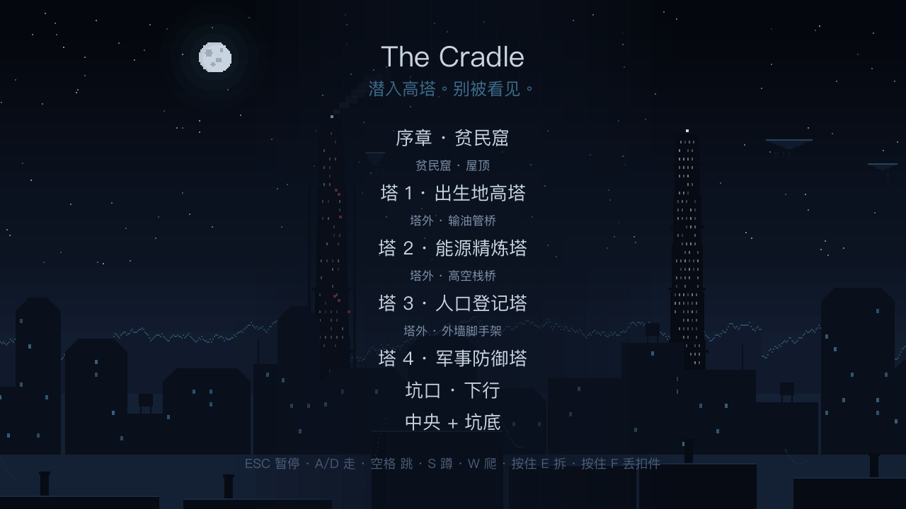
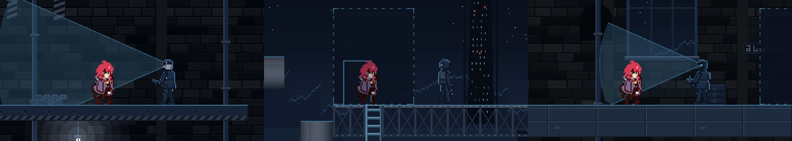
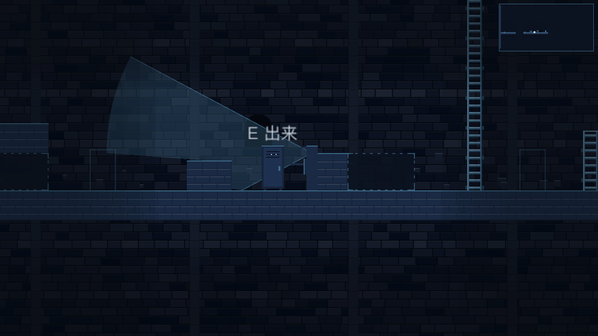
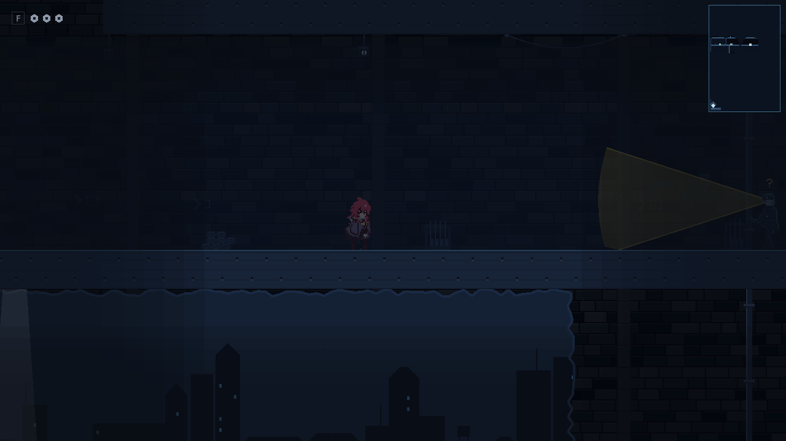

# The Cradle

> 潜入高塔。别被看见。

2D 像素风横版**潜行**游戏 · Godot 4.6 · GDScript

[English](#english)

---

## 下载试玩

- **Windows 试玩版**：到 [Releases](https://github.com/shichunLiao/game-project/releases) 页面下载，解压后双击 `TheCradle.exe`。
  - 如果出现「Windows 已保护你的电脑」，点「更多信息 → 仍要运行」。游戏没有付费的代码签名，所以会有这个提示。
  - 试玩版是 2026-10-14 导出的，之后的修复（比如二段跳的落脚空间）没有包含在里面。
- **从源码运行**：用 [Godot 4.6](https://godotengine.org/) 打开 `project.godot`，按 F5。

## 游戏简介

大陆破碎，「中央」以救灾为名统治一切。陨石坑底藏着旧世界的「方舟」，它强迫整片大陆保持清醒，好从中抽取资源。

贫民窟的小贼 **Ryn** 的姐姐 **Vera** 被抓走，接入了方舟核心，从此失去记忆。Vera 留下的最后一句话是「别来找我」。Ryn 只凭身手和一双巧手，穿过四座高塔下到坑底，用一张姐妹合照唤醒了她。

**序章 · 贫民窟 → 出生地高塔 → 能源精炼塔 → 人口登记塔 → 军事防御塔 → 坑底 → 结局**

## 玩法

整个游戏没有战斗、没有血条。核心循环是：

1. **观察**：看清守卫的巡逻路线、视野锥、探照灯和门禁灯的节奏
2. **等待**：等守卫转身、等窗口打开。时机全靠玩家自己判断，游戏不给提示条
3. **通过**：走暗处、蹲下、攀爬，或者拆掉地板和栅栏，开出一条更暗的路
4. **失手就重来**：一旦被发现，Ryn 会说「不行，这样会被发现。」，然后回到最近的存档点，什么都不扣

主要机制：

- **守卫的三种感知**：视觉（视野锥）、听觉（脚步声和拆东西的声音，蹲着走没有声音）、追踪（循着脚印跟上来）
- **暗处判定**：暗处安全，亮处危险。关卡结构本身就在讲「亮的那边反而更危险」
- **手巧拆物件**：拆开地板盖板和栅栏后路线会改变，守卫可能掉下去，也可能改道
- **丢扣件**：瞄准落点扔出去，把守卫引开
- **躲藏**：可以躲进柜子和通风管，但守卫会检查柜子
- **谜题房间**：每座塔都有一个，包括断桥、蒸汽走廊、控制室和配电室
- **线索链**：通过广播、工牌 V-17、档案终端和守卫的闲聊，一步步拼出 Vera 的下落

## 截图

| 守卫视野锥 | 躲进柜子 | 军事塔熄灯 |
|---|---|---|
|  |  |  |

## 操作

| 动作 | 键盘 | 手柄 |
|---|---|---|
| 移动 | A / D 或 ← → | 十字键 |
| 爬梯 | W / S 或 ↑ ↓ | 十字键上下 |
| 蹲下 | S 或 ↓ | 十字键下 |
| 跳 | 空格 或 K | A |
| 跑 | Shift 或 Ctrl | RB |
| 互动 / 按住拆东西 | E | X |
| 丢扣件 | 按住 F 瞄准，A / D 调落点，松开扔出 | 按住 Y |
| 暂停 / 设置 / 改键 | Esc | Start |
| 全屏 | F11 | |

## 我的职责

- **世界观与剧情**：设定、角色和叙事脚本（[`设定摘要.md`](设定摘要.md)、[`叙事脚本.md`](叙事脚本.md)）
- **关卡与玩法设计**：潜行规则、四座塔「亮处危险、暗处安全」的关卡结构、谜题房间，以及根据试玩反馈做的调整
- **用 AI 协作开发程序**：代码主要由 [Claude Code](https://claude.com/claude-code) 生成。我负责提出需求、拆分里程碑、试玩测试，以及决定改什么、怎么改

## 技术亮点

- **Godot 4.6 + GDScript**：约 135 个脚本、2.2 万行代码
- **关卡描述语言**（[`tools/level_builder`](tools/level_builder)）：用 Python 按 16px 网格写关卡，自动生成 Godot 场景、字符地图和预览图，并检查路线能不能走通
- **全流程节奏检查**（[`tools/pacing`](tools/pacing)）：让机器人沿生成好的路线跑完每一关，统计存档点间隔和需要看时机的「关口」
- **试玩记录和热点图**（[`tools/playtest`](tools/playtest)）：记录真人试玩时在哪里被发现、在哪里停留，生成报告和热点图
- **程序合成配乐**（[`tools/audio/make_music.py`](tools/audio/make_music.py)）：只用 Python 标准库合成菜单、塔外和结局三段音乐，三段共用同一个「姐姐动机」
- **Windows 打包脚本**（[`tools/packaging`](tools/packaging)）：一条命令导出 exe、附上说明并打包成 zip

## 项目结构

| 路径 | 内容 |
|---|---|
| `src/` | 游戏代码：`player`、`guard`、`levels`、`shadow`（暗处判定）、`dismantle`（拆物件）、`ending` 等 |
| `assets/` | 角色和守卫的像素图、配乐、数值配置（`.tres`） |
| `tools/` | 关卡生成、节奏检查、试玩报告、配乐和打包工具 |
| `design/` | 设计简报、关卡地图和预览图、点子清单 |
| `docs/` | 动画、爬梯、打磨等方面的调研笔记 |
| `production/` | 开发任务拆分和 QA 截图记录 |
| `设定摘要.md` `叙事脚本.md` `美术规格.md` `里程碑排期.md` | 最初手写的四份设计文档 |

## 说明

- 开发流程使用了 [Claude Code Game Studios](https://github.com/Donchitos/Claude-Code-Game-Studios) 模板（MIT 许可证，作者 Donchitos）。模板自带的 AI 配置和框架文件没有放进这个仓库。

---

## English

**The Cradle** is a 2D pixel-art stealth platformer made with Godot 4.6 and GDScript.

Ryn, a young thief from the slums, sneaks through four towers to reach the bottom of a crater and wake her sister Vera. Vera was taken, wired into the core of the "Ark", and lost her memory. There is no combat and no health bar. You watch, wait, and slip past. If you are seen, you restart at the last checkpoint.

- **Guards** see (vision cones), hear (footsteps and dismantling noise), and track footprints
- **Darkness** keeps you safe and light gets you caught, so the broken, dark path is usually the right one
- **Dismantle** floor panels and fences to change the route, **throw** bolts to lure guards, and **hide** in lockers and vents
- **Tools**: a Python level DSL that generates Godot scenes and checks reachability, an automated pacing run, playtest heatmaps, and procedurally synthesized music

**My role:** world and story, level and stealth design, and AI-assisted programming. Most of the code was generated with Claude Code. I set the requirements and milestones, playtested, and decided what to change.

**Play:** download the Windows build from [Releases](https://github.com/shichunLiao/game-project/releases), or open `project.godot` in Godot 4.6.
