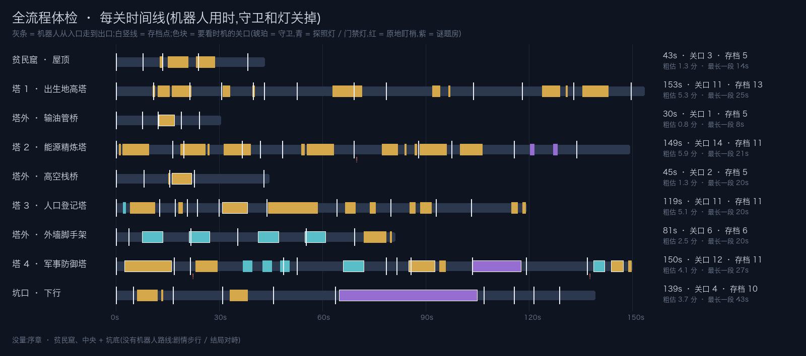

# 全流程体检 · 2026-10-14

> 由 `tools/pacing/run_pacing.py` 生成。路线机器人(`--demo=route --pace`)沿关卡生成器的路线走完每一关,守卫和灯都关掉;`src/dev/pace_probe.gd` 一路记存档点和「关口」。**只是观察**:标出来的地方值得试玩时看一眼,不等于有问题。

**关口**:Ryn 站的地方被某个守卫巡逻范围里任一位置(它会有的朝向)看得到 —— 不在暗处、没被墙挡 ——或者在探照灯 / 门禁灯的范围里。连续一段(中间断开不到 0.75 秒)算一个。和守卫当时走到哪、面朝哪无关。

**粗估玩家用时** = 机器人用时 × 1.3 + 每个关口等半个来回(原地盯梢的守卫按 5 秒算)。不含死亡重来、看风景、读字。

## 总览

量到的 9 关:机器人共 **15.2 分钟**,粗估玩家 **30 分钟左右**(再加死亡重来)。没量:序章 · 贫民窟、中央 + 坑底。

| 关卡 | 机器人 | 粗估玩家 | 存档点(碰得到 / 总共) | 关口 | 每分钟关口 | 最长一段(存档间) | 死一次最多重走 | 靠暗处躲过 | 守卫 / 灯 |
|---|---|---|---|---|---|---|---|---|---|
| 贫民窟 · 屋顶 | 43s | 1.3 分 | 5 / 5 | 3 | 4.2 | 14s | 15s | 3s | 2 / 0 |
| 塔 1 · 出生地高塔 | 153s | 5.3 分 | 13 / 13 | 11 | 4.3 | 25s | 19s | 7s | 9 / 0 |
| 塔外 · 输油管桥 | 30s | 0.8 分 | 5 / 5 | 1 | 2.0 | 8s | 5s | 0s | 1 / 1 |
| 塔 2 · 能源精炼塔 | 149s | 5.9 分 | 11 / 11 | 14 | 5.6 | 21s | 19s | 5s | 11 / 0 |
| 塔外 · 高空栈桥 | 45s | 1.3 分 | 5 / 5 | 2 | 2.7 | 20s | 8s | 1s | 1 / 1 |
| 塔 3 · 人口登记塔 | 119s | 5.1 分 | 11 / 11 | 11 | 5.5 | 20s | 16s | 12s | 9 / 5 |
| 塔外 · 外墙脚手架 | 81s | 2.5 分 | 6 / 6 | 6 | 4.4 | 20s | 26s | 2s | 1 / 4 |
| 塔 4 · 军事防御塔 | 150s | 4.1 分 | 11 / 11 | 12 | 4.8 | 27s | 29s | 2s | 7 / 9 |
| 坑口 · 下行 | 139s | 3.7 分 | 10 / 10 | 4 | 1.7 | 43s | 41s | 4s | 3 / 2 |

## 这份体检量不到的

- 机器人不等时机、不躲、不丢扣件,也不解谜题房(放汽、断电、排干),只拆挡路的机关。谜题房那几段的用时按「没解」算:下行关的蚀池是用 1/4 速度硬走过去的,实际排干后会快很多。
- 关口是「这个位置被谁盯得到」的范围,不是被抓的次数;探照灯按整段扫射范围算,所以灯的关口偏长。
- 序章(剧情步行)和中央 + 坑底(结局对峙)没有机器人路线,没量。
- 粗估玩家用时只是公式,真实数字要试玩;死亡重来没算进去。

## 每关标记

⚑ = 值得看:主路线碰不到的存档点;两个存档点之间机器人走 > 45 秒;两个存档点之间 ≥ 3 个关口;原地盯梢的守卫看着路线(谜题房以外)。

ℹ = 记一笔:存档点站的地方被盯得到(重生后要马上躲);谜题房里的关口(要先解机关);巡逻守卫的关口比半个来回长(中途要躲一次,潜行的常态)。

### 贫民窟 · 屋顶  (`src/levels/slum_rooftops.tscn`)

- 结果 REACHABLE;走了 5357px;路线动作:climb_up 1, drop 1, gap 6, jump 9, walk 12
- 没有标记

| 存档段 | 起点 | 机器人用时 | 关口 | 死一次最多重走 |
|---|---|---|---|---|
| 1 | Checkpoint00 | 8s | 0 | 0s |
| 2 | Checkpoint01 | 6s | 1 | 6s |
| 3 | Checkpoint02 | 10s | 2 | 15s |
| 4 | Checkpoint03 | 14s | 0 | 0s |
| 5 | Checkpoint04 | 5s | 0 | 0s |

### 塔 1 · 出生地高塔  (`src/levels/tower_1_birthplace.tscn`)

- 结果 REACHABLE;走了 13795px;路线动作:climb_up 7, crawl 2, drop 1, gap 6, jump 11, panel 1, vent 1, walk 24
- ℹ 存档点 Checkpoint01(x=695, y=2784)站的地方 GuardA 盯得到 —— 死了在这里重生,要马上找掩护
- ℹ 存档点 Checkpoint02(x=1799, y=2784)站的地方 GuardB 盯得到 —— 死了在这里重生,要马上找掩护
- ℹ 存档点 Checkpoint04(x=1059, y=2301)站的地方 GuardC/GuardD 盯得到 —— 死了在这里重生,要马上找掩护
- ℹ 存档点 Checkpoint07(x=1751, y=1888)站的地方 GuardF 盯得到 —— 死了在这里重生,要马上找掩护

| 存档段 | 起点 | 机器人用时 | 关口 | 死一次最多重走 |
|---|---|---|---|---|
| 1 | Checkpoint00 | 11s | 1 | 11s |
| 2 | Checkpoint01 | 11s | 2 | 11s |
| 3 | Checkpoint02 | 9s | 0 | 0s |
| 4 | Checkpoint03 | 9s | 2 | 10s |
| 5 | Checkpoint04 | 3s | 0 | 0s |
| 6 | Checkpoint05 | 9s | 0 | 0s |
| 7 | Checkpoint06 | 16s | 1 | 19s |
| 8 | Checkpoint07 | 9s | 0 | 0s |
| 9 | Checkpoint08 | 25s | 2 | 18s |
| 10 | Checkpoint09 | 14s | 0 | 0s |
| 11 | Checkpoint10 | 15s | 2 | 13s |
| 12 | Checkpoint11 | 17s | 1 | 10s |
| 13 | Checkpoint12 | 4s | 0 | 0s |

### 塔外 · 输油管桥  (`src/levels/pipeline_bridge.tscn`)

- 结果 REACHABLE;走了 4102px;路线动作:drop 1, gap 3, jump 4, walk 7
- ℹ GuardA/Sweep00 的关口要走 4.5 秒,比半个来回长 —— 中途要躲一次(x=1389, y=480)

| 存档段 | 起点 | 机器人用时 | 关口 | 死一次最多重走 |
|---|---|---|---|---|
| 1 | Checkpoint00 | 8s | 0 | 0s |
| 2 | Checkpoint01 | 4s | 0 | 0s |
| 3 | Checkpoint02 | 7s | 1 | 5s |
| 4 | Checkpoint03 | 5s | 0 | 0s |
| 5 | Checkpoint04 | 6s | 0 | 0s |

### 塔 2 · 能源精炼塔  (`src/levels/tower_2_refinery.tscn`)

- 结果 REACHABLE;走了 13986px;路线动作:climb_up 14, crawl 1, dismantle_fence 1, drop 1, gap 1, jump 13, walk 31
- ⚑ Checkpoint06 之后连着 3 个关口,死一次最多重走 18 秒
- ℹ 存档点 Checkpoint02(x=1784, y=2336)站的地方 GuardB 盯得到 —— 死了在这里重生,要马上找掩护
- ℹ 存档点 Checkpoint03(x=440, y=2112)站的地方 GuardC 盯得到 —— 死了在这里重生,要马上找掩护
- ℹ 谜题房 蒸汽阀 Steam00:GuardS1 盯着(x=640, y=784,1.2 秒) —— 设计上要先解机关,机器人没解
- ℹ 谜题房 蒸汽阀 Steam01:GuardS2 盯着(x=1344, y=784,1.2 秒) —— 设计上要先解机关,机器人没解

| 存档段 | 起点 | 机器人用时 | 关口 | 死一次最多重走 |
|---|---|---|---|---|
| 1 | Checkpoint00 | 16s | 2 | 10s |
| 2 | Checkpoint01 | 3s | 1 | 10s |
| 3 | Checkpoint02 | 17s | 2 | 19s |
| 4 | Checkpoint03 | 5s | 0 | 0s |
| 5 | Checkpoint04 | 6s | 0 | 0s |
| 6 | Checkpoint05 | 21s | 2 | 15s |
| 7 | Checkpoint06 | 19s | 3 | 18s |
| 8 | Checkpoint07 | 10s | 1 | 8s |
| 9 | Checkpoint08 | 18s | 1 | 9s |
| 10 | Checkpoint09 | 18s | 2 | 13s |
| 11 | Checkpoint10 | 15s | 0 | 0s |

### 塔外 · 高空栈桥  (`src/levels/sky_bridge.tscn`)

- 结果 REACHABLE;走了 4334px;路线动作:climb_down 4, drop 1, gap 3, jump 2, walk 10
- ℹ GuardA/Sweep00 的关口要走 5.6 秒,比半个来回长 —— 中途要躲一次(x=1729, y=352)

| 存档段 | 起点 | 机器人用时 | 关口 | 死一次最多重走 |
|---|---|---|---|---|
| 1 | Checkpoint00 | 8s | 0 | 0s |
| 2 | Checkpoint01 | 8s | 1 | 8s |
| 3 | Checkpoint02 | 7s | 1 | 6s |
| 4 | Checkpoint03 | 20s | 0 | 0s |
| 5 | Checkpoint04 | 2s | 0 | 0s |

### 塔 3 · 人口登记塔  (`src/levels/tower_3_registry.tscn`)

- 结果 REACHABLE;走了 10425px;路线动作:climb_up 6, gap 1, jump 9, panel 3, vent 6, walk 25
- ℹ Gate03/GuardD2 的关口要走 7.3 秒,比半个来回长 —— 中途要躲一次(x=927, y=1440)

| 存档段 | 起点 | 机器人用时 | 关口 | 死一次最多重走 |
|---|---|---|---|---|
| 1 | Checkpoint00 | 13s | 2 | 11s |
| 2 | Checkpoint01 | 5s | 0 | 0s |
| 3 | Checkpoint02 | 4s | 1 | 2s |
| 4 | Checkpoint03 | 3s | 0 | 0s |
| 5 | Checkpoint04 | 6s | 0 | 0s |
| 6 | Checkpoint05 | 14s | 1 | 8s |
| 7 | Checkpoint06 | 20s | 1 | 15s |
| 8 | Checkpoint07 | 16s | 2 | 11s |
| 9 | Checkpoint08 | 13s | 2 | 12s |
| 10 | Checkpoint09 | 10s | 0 | 0s |
| 11 | Checkpoint10 | 16s | 2 | 16s |

### 塔外 · 外墙脚手架  (`src/levels/scaffold_descent.tscn`)

- 结果 REACHABLE;走了 8662px;路线动作:climb_down 2, drop 3, walk 6
- ℹ 存档点 Checkpoint02(x=1656, y=896)站的地方 Sweep01 盯得到 —— 死了在这里重生,要马上找掩护
- ℹ 存档点 Checkpoint04(x=1656, y=1728)站的地方 Sweep03 盯得到 —— 死了在这里重生,要马上找掩护

| 存档段 | 起点 | 机器人用时 | 关口 | 死一次最多重走 |
|---|---|---|---|---|
| 1 | Checkpoint00 | 4s | 0 | 0s |
| 2 | Checkpoint01 | 18s | 2 | 24s |
| 3 | Checkpoint02 | 14s | 0 | 0s |
| 4 | Checkpoint03 | 20s | 2 | 26s |
| 5 | Checkpoint04 | 14s | 0 | 0s |
| 6 | Checkpoint05 | 12s | 2 | 11s |

### 塔 4 · 军事防御塔  (`src/levels/tower_4_military.tscn`)

- 结果 REACHABLE;走了 13429px;路线动作:climb_up 10, crawl 1, gap 2, jump 15, panel 2, walk 31
- ⚑ Checkpoint02 之后连着 4 个关口,死一次最多重走 29 秒
- ⚑ Checkpoint10 之后连着 3 个关口,死一次最多重走 13 秒
- ℹ 存档点 Checkpoint03(x=345, y=1984)站的地方 Sweep02 盯得到 —— 死了在这里重生,要马上找掩护
- ℹ 存档点 Checkpoint07(x=1433, y=1296)站的地方 Sweep04 盯得到 —— 死了在这里重生,要马上找掩护
- ℹ GuardA/Sweep00/Sweep01 的关口要走 13.7 秒,比半个来回长 —— 中途要躲一次(x=333, y=2784)
- ℹ 谜题房 配电箱 Fuse00:GuardT/Sweep05/Sweep06 盯着(x=622, y=992,14.0 秒) —— 设计上要先解机关,机器人没解

| 存档段 | 起点 | 机器人用时 | 关口 | 死一次最多重走 |
|---|---|---|---|---|
| 1 | Checkpoint00 | 17s | 1 | 16s |
| 2 | Checkpoint01 | 5s | 0 | 0s |
| 3 | Checkpoint02 | 27s | 4 | 29s |
| 4 | Checkpoint03 | 4s | 0 | 0s |
| 5 | Checkpoint04 | 26s | 1 | 19s |
| 6 | Checkpoint05 | 3s | 0 | 0s |
| 7 | Checkpoint06 | 4s | 1 | 11s |
| 8 | Checkpoint07 | 18s | 1 | 10s |
| 9 | Checkpoint08 | 16s | 1 | 14s |
| 10 | Checkpoint09 | 18s | 0 | 0s |
| 11 | Checkpoint10 | 13s | 3 | 13s |

### 坑口 · 下行  (`src/levels/pit_descent.tscn`)

- 结果 REACHABLE;走了 10773px;路线动作:climb_down 3, drop 6, walk 10
- ℹ 谜题房 蚀池放流 Drain00:GuardP5/Sweep00/Sweep01 盯着(x=204, y=1152,40.2 秒) —— 设计上要先解机关,机器人没解

| 存档段 | 起点 | 机器人用时 | 关口 | 死一次最多重走 |
|---|---|---|---|---|
| 1 | Checkpoint00 | 5s | 0 | 0s |
| 2 | Checkpoint01 | 11s | 2 | 8s |
| 3 | Checkpoint02 | 14s | 0 | 0s |
| 4 | Checkpoint03 | 15s | 1 | 7s |
| 5 | Checkpoint04 | 18s | 0 | 0s |
| 6 | Checkpoint05 | 43s | 1 | 41s |
| 7 | Checkpoint06 | 9s | 0 | 0s |
| 8 | Checkpoint07 | 6s | 0 | 0s |
| 9 | Checkpoint08 | 8s | 0 | 0s |
| 10 | Checkpoint09 | 10s | 0 | 0s |
